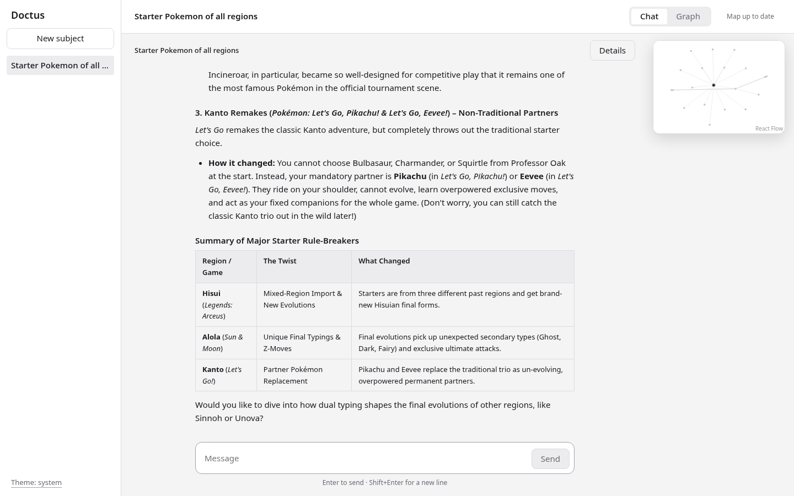

# Doctus

*Latin: "one who teaches."*

Doctus is a learning companion. You chat with a tutor as you would with any
good AI assistant, and a map of what you explored and were taught grows
alongside the chat: a branching canvas of conversations, with the
evidence-backed concepts each one taught.

> **Status:** M3 (the branch-canvas backend) is in review. The M2 web UI
> still talks to the retired concept-chat endpoints, so it does not work
> against this backend; M4 replaces it with the canvas UI. See
> [Implemented vs in progress](#implemented-vs-in-progress).



More in [docs/screenshots/m2/](docs/screenshots/m2/): the graph screen at
each zoom level and the floating chat window, from a short live Gemini
session.

## Design

- **Exploration canvas, not a roadmap.** A subject is a branching tree that
  records where the learner actually went, like the trail of a Wikipedia
  game. It does not lay out a syllabus in advance.
- **Canvas nodes** form the tree; each has one parent, and the root is the
  chat where the subject began.
  - `chat` node: its own conversation with the tutor. A follow-up inside the
    node continues it; going somewhere new is a child chat node.
  - `note` node: the learner's own Markdown. No AI.
  - The learner creates the nodes; the tutor only *suggests* branches.
- **Concepts** are the evidence layer. The cartographer extracts the
  concepts *taught* in a chat node. Every concept needs at least one quote
  copied from that node's conversation; code checks each quote against the
  stored messages (ignoring case, whitespace and markdown emphasis), and a
  concept with no verified quote is not created. A concept means taught, not
  learned. It is homed in the node where it was first taught; teaching it
  again elsewhere adds evidence to the same concept (names are deduped
  within the subject).
- **Concept links** (directed, typed), drawn between the canvas nodes that
  home their two concepts, so they can cross branches:
  - `prerequisite`: A must be understood before B; the reason must match the
    arrow. No cycles.
  - `related`: adjacent, no direction meaning.
  - `part_of` is retired: the branch tree is the hierarchy. Old `part_of`
    edges stay in the database and are left out of the canvas.
- **Suggestions.** After each exchange the cartographer may offer up to 3
  follow-up questions for that node. Accepting one creates a child chat node
  with it as the first question. A suggestion is never a node or a concept
  until accepted.
- **Two AI layers** with separate prompts:
  1. **Tutor**: talks with the learner and never mentions the canvas, nodes
     or concepts. It sees the node's branch (its ancestors' conversations,
     oldest trimmed first to a budget and then named by title; sibling
     branches excluded), notes on that path quoted as the learner's own
     words, and quiet concept context (what this branch taught, and
     prerequisites taught elsewhere).
  2. **Cartographer**: after each full or stopped reply, one call returns the
     node's concepts with evidence, concept links, the node's title and
     keyword, and up to 3 suggestions. The title is set from the first
     exchange and changes only if the topic clearly shifts.
- **Mastery is not decided.** Strength and decay go through a swappable
  `MasteryModel` interface; the current `PlaceholderDecayModel` is a stand-in.

## Implemented vs in progress

M3, branch canvas (backend, in review):

- `canvas_nodes` tree (one parent, one root per subject, no move operation,
  so no cycles), `suggestions`, `messages.canvas_node_id` and `stopped`,
  `nodes.home_canvas_node_id`. Schema version via `PRAGMA user_version`;
  the migration gives each existing subject one root chat node holding all
  its messages (M1/M2 per-concept chats merged in id order; dev data) and
  keeps a copy of the old database as `doctus.db.pre-m3`.
- Endpoints for the canvas, child/sibling nodes, note and prompt edits,
  note/chat switching before an answer, branch delete with confirmation,
  subject rename, suggestions, branch path, search, and streamed replies with
  stop (see [API](#api)). Every canvas change bumps `graph_version`.
- Deleting a branch deletes concepts left with no evidence and rehomes
  concepts that still have evidence elsewhere.
- Tutor replies stream as server-sent events; a stopped reply keeps what was
  written, and the cartographer runs only after the stream has finished.

Implemented earlier:

- SQLite store (WAL) with anonymous visitor scoping (`X-Doctus-Visitor`
  header).
- LLM layer: Gemini and a deterministic `FakeLLM`; structured output is
  validated with Pydantic and retried once.
- **Tutor** and **cartographer** as separate layers with separate prompts.
  The cartographer can use its own model (`DOCTUS_GRAPH_MODEL`).
- The cartographer runs after every exchange, in the background, so the
  reply is never delayed. Runs are serialised per subject; messages that
  arrive during a run get one more run right after it. Every run also sweeps
  the subject for any chat node whose latest reply was never processed, so a
  node whose own run failed (for example a 429), hit an unexpected error or
  was lost to a restart is picked up by the next run anywhere in the
  subject. A failed node is not retried within the same run, and its error
  stays reported even if later nodes succeed. Clients poll
  `graph_version` and `cartographer: idle | running | error`.
- Evidence check on every node except the origin; no suggestion or
  frontier nodes.
- Edge kinds `prerequisite`, `part_of` and `related`; one `part_of` parent
  per node; cycle checks per directed kind.
- Traversal helpers: `ancestors` and `descendants` by kind, `part_of_root`,
  and the shortest `path` between two nodes.
- Trail with `from_node_id`; distance from the origin.
- 310 backend offline tests; opt-in live Gemini tests. 24 frontend unit
  tests (Vitest).

M2, UI (`frontend/`, merged; superseded by M4): React + TypeScript + Vite,
React Flow. It used the concept-chat endpoints that M3 removed.

- Subject list and a "start a subject" form.
- Chat screen: markdown replies (tables, code), Enter to send and
  Shift+Enter for a new line, a pending indicator, clear errors (429 shows
  "rate limited, try again in N s"), a trail breadcrumb, a node detail
  drawer (summary, evidence quotes, connections) and a live mini graph.
- Graph screen: the full graph; selecting a node opens its chat in a
  floating window (minimise, close, expand to the chat screen). Opening a
  chat records a trail step (`POST /api/nodes/{id}/visit`).
- Semantic zoom by size: a node at `part_of` depth d is drawn at
  S(d) = 160 px × 0.75^d. When S(d) × zoom drops below 48 px it merges into
  its nearest visible `part_of` ancestor, which stays under its own name
  and grows with the square root of what it holds (capped). It splits out
  again above 48 × 1.15 px. The origin and its direct parts, and any node
  without a `part_of` parent, never merge, and the furthest zoom-out is
  48 / 160 = 0.3. Edges inside a group are hidden; parallel edges between
  groups are merged into one thicker line. The constants are in
  `frontend/src/theme.css`.
- Layout: radial seed (origin at the centre, `part_of` children around
  their parent, other topics on rings by distance) relaxed by a short,
  deterministic spring pass. Positions are kept as the graph grows; "Tidy
  layout" recomputes them.
- After each message the UI polls `/graph/status` until the cartographer is
  idle, then refreshes the graph; new nodes briefly highlight.
- "Context used" toggle on replies received in the current session.
- Light and dark themes with neutral placeholder styling. The visual design
  is not decided: every colour, font, size, radius and spacing value is a
  CSS variable in `frontend/src/theme.css`.

## Run it

Needs [uv](https://docs.astral.sh/uv/), Node 24 with npm, and GNU Make.

```bash
cp backend/.env.example backend/.env   # then add GEMINI_API_KEY
make dev                               # UI at http://localhost:5173, API docs at :8000/docs
```

`make dev` starts the backend and the Vite dev server together (Vite
proxies `/api`); Ctrl-C stops both. The browser keeps its anonymous visitor
token in `localStorage` (in memory when storage is unavailable).

Offline, with canned model answers and no key:

```bash
cd backend && DOCTUS_LLM=fake uv run uvicorn doctus.main:app --reload
```

Every request needs an `X-Doctus-Visitor` header (any string of 16+
characters).

| Variable | Default | Purpose |
|---|---|---|
| `GEMINI_API_KEY` | empty | Gemini API key |
| `DOCTUS_LLM` | `gemini` | `gemini` or `fake` |
| `DOCTUS_GEMINI_MODEL` | `gemini-3.5-flash-lite` | Any Gemini model your key can use |
| `DOCTUS_GRAPH_MODEL` | empty (= chat model) | Model for the cartographer |
| `DOCTUS_DB` | `doctus.db` | SQLite file (relative to `backend/`) |
| `DOCTUS_CONTEXT_CHARS` | `24000` | Characters of branch conversation sent to the tutor; older ancestor nodes are trimmed whole beyond this |

Real environment variables win over `backend/.env`.

## Tests and lint

```bash
make test   # backend (FakeLLM, no API key) and frontend (Vitest) tests
make lint   # ruff check, ruff format --check, oxlint, tsc
make build  # production build of the frontend
make fmt    # apply ruff fixes and formatting (backend)
```

Screenshots of a running dev session (not part of CI; uses Playwright,
optionally with a system Chromium):

```bash
cd frontend && CHROMIUM_PATH=/usr/bin/chromium node scripts/screenshots.mjs \
  --subject 1 --visitor <token> --out screenshots --chat <node> --window <node>
```

The opt-in live test makes one real chat call and one structured call:

```bash
cd backend && uv run python -m pytest -m live
```

## API

```
GET    /api/subjects                          list your subjects
POST   /api/subjects                          {title, goal?, first_question?} -> subject
                                              (with root_canvas_node_id)
PATCH  /api/subjects/{id}                     {title}: rename

GET    /api/subjects/{id}/canvas              nodes (with messages and concept chips),
                                              links mapped to node pairs, open
                                              suggestions, graph_version, cartographer
GET    /api/subjects/{id}/canvas/status       {graph_version, cartographer, error} (poll this)
GET    /api/subjects/{id}/search?q=           hits in titles, messages, notes, concepts:
                                              {canvas_node_id, field, snippet}

GET    /api/canvas-nodes/{id}                 detail: messages, concepts with evidence,
                                              links, concepts also taught here, suggestions
GET    /api/canvas-nodes/{id}/path            root-to-node chain as one document
POST   /api/canvas-nodes/{id}/children        {kind: chat|note, text} -> new last child
POST   /api/canvas-nodes/{id}/siblings        {kind, text} -> new node right after this one
PATCH  /api/canvas-nodes/{id}                 {kind?, prompt?, note_body?}: kind and prompt
                                              only before the node has an answer (409 after)
DELETE /api/canvas-nodes/{id}[?confirm=branch]  a node with children needs confirm=branch;
                                              the root cannot be deleted
POST   /api/canvas-nodes/{id}/chat            {message?} -> SSE stream (below); no message
                                              answers the node's waiting question
POST   /api/canvas-nodes/{id}/stop            stop the reply being written (409 if none)
POST   /api/canvas-nodes/{id}/extract         run the cartographer now (409 while one runs)
POST   /api/suggestions/{id}/accept           -> new child chat node with that question

# M1/M2 concept views, kept read-only, and the older starter-map flow:
GET    /api/subjects/{id}/graph[/status]      concepts, edges, trail, run stats
GET    /api/nodes/{id}                        one concept: evidence (with canvas node), edges
POST   /api/nodes/{id}/visit                  {from_node_id?}: record a trail step
POST   /api/subjects/{id}/skeleton            propose a starter map
GET    /api/subjects/{id}/proposals           pending proposals
POST   /api/proposals/{id}/accept|reject
```

Starting a subject: either send `first_question` with `POST /subjects` and
then `POST /canvas-nodes/{root}/chat` with no message, or create it empty and
send the first `/chat {message}` on the root.

The chat stream is `text/event-stream`:

```
event: start   data: {user_message_id, context_used}
event: delta   data: {text}                        (repeated)
event: done    data: {message_id, stopped, graph_version, cartographer, error}
event: error   data: {status, message, retry_after?, message_id}   (failure mid-reply)
```

The question is saved before the model is called. A failure before the
first piece is a plain HTTP error (429 with `Retry-After` for rate limits,
502 otherwise) and leaves the question waiting, so the client can retry with
no message or edit it. A stop (or a dropped connection, or a failure
mid-reply) saves what was written as a reply with `stopped: true`. The
cartographer starts after the stream has finished; poll `/canvas/status`
until `cartographer` is `idle` (or `error`), then fetch `/canvas`.

**Single worker.** Replies in progress and their stop flags are kept in
process memory, as are cartographer runs, so run one server process (the
default `uvicorn` command). Several workers against one database would not
see each other's streams or runs.

## Layout

```
backend/
  src/doctus/
    api.py           HTTP endpoints
    tutor.py         the tutor layer: prompt and chat call
    cartographer.py  the cartographer layer: evidence-checked concepts, links,
                     title/keyword, suggestions; background runs
    store.py         SQLite storage, migration, canvas tree, visitor scoping,
                     edge rules, traversal, search
    graph.py         distance from origin; older proposal flow
    context.py       the tutor's branch context (trimming, notes, concepts)
                     and the "context used" record
    mastery.py       swappable mastery model (placeholder rule)
    prompts.py       prompts and structured-output schemas
    llm/             provider interface, Gemini, fake model for tests
  tests/
frontend/
  src/
    api/             typed client (visitor header, 429 + Retry-After)
    graph/           layout, semantic zoom, React Flow canvas
    chat/            thread, composer, markdown, node detail
    screens/         home, chat screen, graph screen
    shell/           app shell, chat window, breadcrumb
    state/           per-subject state: graph, polling, positions
    theme.css        all design tokens (placeholder, neutral)
docs/eval/         small pilot results (not benchmarks)
```

## Current limits

- The UI has no visual design yet (neutral placeholder theme).
- At the furthest zoom-out, node labels are too small to read (about 5 px):
  the 48 px minimum limits the node box, not its text.
- Duplicate detection is by normalised name only; near-synonyms can become
  separate nodes.
- The evidence check proves a quote is in the chat, not that the concept was
  taught well; the model still chooses which concepts to record.
- The tutor on `gemini-3.5-flash-lite` makes small factual slips (5 in about
  16 replies in testing). The evidence check proves a quote is in the chat,
  not that what it says is correct. A stronger tutor model is planned.
- Narrative subjects (for example a TV episode) produce plot or cause links
  rather than learning dependencies.
- Tests and mastery updates are not wired to endpoints yet.
- Single process, SQLite, no accounts (anonymous visitor tokens).
- Free-tier Gemini rate limits are low. Each exchange is two calls (tutor
  and cartographer), so a burst of messages can return 429.
- Cartographer runs and streamed replies are coordinated in process memory;
  running several server processes against one database is not supported.
- A stop takes effect at the next piece the model sends, not instantly.
- A note's keyword is simply its title's first word (no model call).
- The M2 UI does not work against the M3 backend; M4 replaces it.

## Pilot results

Small hand-run pilots are in
[docs/eval/](docs/eval/). They are not benchmarks.

## License

To be decided.
