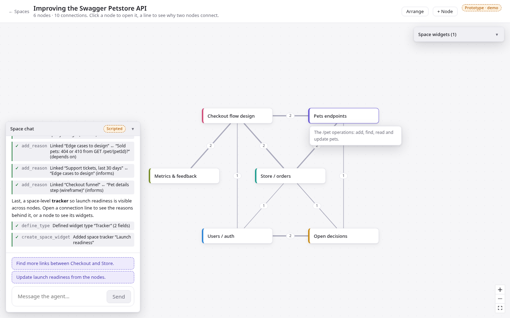
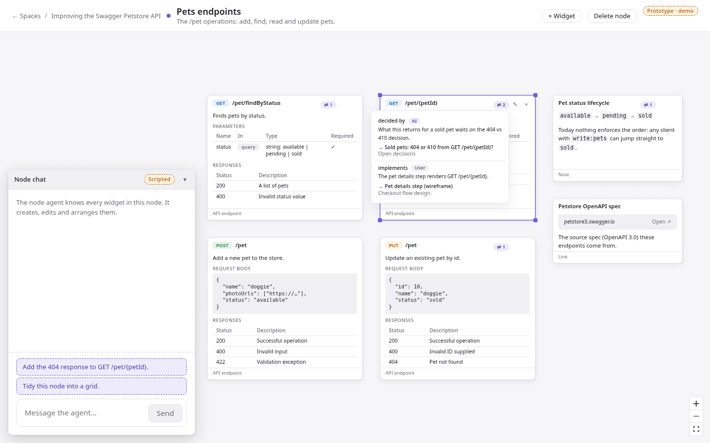
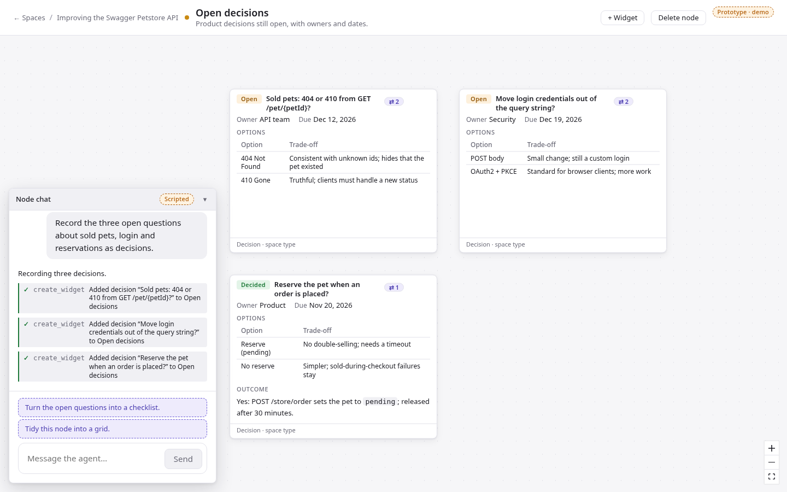
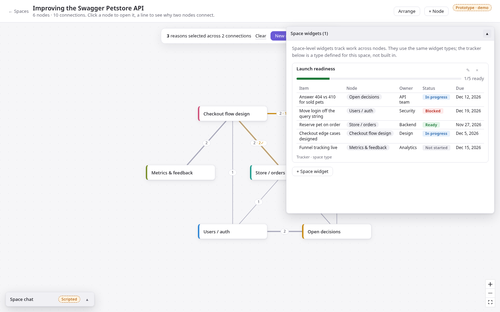

# Doctus

A visual workspace where an AI helps you build **nodes** and the
**connections** between them, on one canvas. The v1 flagship is product
managers: understanding or improving a product through its endpoints, designs,
flows and decisions.

> **Status: P0, a clickable prototype.** The UI below runs entirely in the
> browser on a mock API, and the agents are **scripted demos**, not a model.
> The data shapes match what the N1 backend will serve. The product was
> redirected on 2026-11-28; the v1 learning product (tutor, cartographer,
> concepts) is in git history and its backend is removed in N1.


The same flow as video: [docs/demo/p0-demo.webm](docs/demo/p0-demo.webm)
(2× speed). Screenshots: [docs/screenshots/p0/](docs/screenshots/p0/).

## The idea

- **Space**: one canvas of nodes.
- **Node**: an object on the space canvas. Inside it is its own canvas of
  widgets, plus its own AI chat.
- **Widget**: a typed item in a node (note, image, link, table, checklist,
  OpenAPI endpoint, …), freely placed and resized.
- **Reason**: one way two nodes relate: a widget in node A ↔ a widget in
  node B, with a kind, a one-line explanation and an author (AI or user).
- **Connection**: derived, never drawn. Two nodes are connected iff at least
  one reason links them; the space canvas draws one line per pair, thicker
  with more reasons.

The UI says "node"; the code and the API still say `world` (`World`,
`world_id`, `create_world`, `/s/:space/w/:world`) until a later rename.

## What the prototype shows



- **No side panels.** The home screen lists the spaces; each screen's top
  bar starts with **← Spaces** (and, inside a node, the space it belongs
  to). Chats and space-level widgets are **floating windows**: drag one by
  its title bar, minimise it to a small bar (▾/▴ or double-click the bar).
  Each window remembers its position and state in this browser.
- **Space canvas** (React Flow): nodes are compact, just a colour and a
  title; the summary shows on hover. Click a node to open it; drag to move
  it (positions saved). One line per pair of nodes, its width and label from
  the reason count. **Arrange** tidies the node positions so fewer lines
  cross (a small search over a staggered grid: crossings first, then line
  length, then lines running through other nodes; same space, same result).
- **Connection view**: click a line for a floating table of its reasons
  (kind, text, AI/User, both widgets with jump links). Edit, delete, or add
  a reason. Select reasons **across several connections**; the tray then
  offers **New node from selection**, which copies (default) or moves the
  referenced widgets. Copies keep `copied_from` and show where they came
  from; moved widgets keep all their reasons.
- **Inside a node**: a canvas of widgets. Drag by the header, resize when
  selected, double-click (or ✎) to edit in place, × to delete (with its
  reasons). Each widget shows its reasons (⇄ n) with jumps to the widget in
  the other node, which is centred and flashed.
- **Widgets are data-defined.** A widget type is a schema of primitive
  fields (`text`, `number`, `date`, `bool`, `enum`, `url`, `file`, `ref`,
  `code`, `list`, `table`) plus a view template (`card`, `table`, `list`,
  `checklist`, `embed`, `image`). Renderers and editors are generic: one per
  template and one per primitive. Widget data is validated against its
  schema on every write, and errors show in the editor.
- **A type that is not built in**: the space agent defines a **Decision**
  type for the Petstore space (question, status, owner, due date, options
  table, outcome) and the Open decisions node uses it, through exactly the
  same system as the built-ins.
- **Space-level widgets**: the Space widgets window (top right, minimised at
  first) holds **Launch readiness**, a tracker (another space-defined type:
  items with a node reference, owner, status and due date, with a progress
  bar).
- **Space chat and node chat** (floating, docked bottom-left) with scripted
  agents. Suggested prompts are shown as chips; the reply streams, and every
  tool call shows as a line (✓ or a rejection). The canvas updates as the
  agent works, and Stop keeps what was done so far. A minimised chat keeps
  streaming. The space agent can instruct a node agent; that exchange
  appears in the node's chat.
  - Empty space: "I'm a PM improving the Swagger Petstore API" builds six
    nodes, 22 widgets, the Decision and Tracker types, 13 reasons and
    the tracker.
  - Space: find more links between Checkout and Store; update launch
    readiness from the nodes.
  - Pets endpoints: add the 404 response to `GET /pet/{petId}`.
  - Open decisions: turn the open questions into a checklist.
  - Any node: tidy into a grid.
  - Anything else gets a short "this is a scripted prototype" reply.

Inside a node, the space-defined Decision type, and the tracker window:





## How the prototype works

- `frontend/src/api/client.ts` defines `DoctusApi`, the interface every
  screen uses. In P0 it is backed by `frontend/src/mock/`; N1 adds an HTTP
  implementation of the same interface.
- `mock/db.ts` holds the data and every rule: schema validation, the evidence
  rule (a reason needs two existing widgets in nodes of one space), cascades
  (widget → its reasons; node → its widgets), connection derivation, copy vs
  move. Pure TypeScript with unit tests, as a spec for N1.
- `mock/agents/` holds the tools the N2 agents will have
  (`create_world`, `create_widget`, `update_widget`, `add_reason`,
  `define_type`, `arrange_widgets`, …) and the scripted runner. Tool calls go
  through the same validation as the UI; a node agent may only touch its own
  node. The seed is the headline script played instantly, so the seeded
  space and the live demo match.
- Data is kept in `localStorage` under a schema version
  (`doctus.proto.version`). When the version changes, the saved data is
  dropped and the seed is loaded again. Every storage access is guarded;
  without storage the data lives in memory. **Reset demo** (on the home
  screen) reloads the seed.
- Light theme only for now; every colour is a variable in
  `frontend/src/theme.css`.

Endpoint data follows the public Swagger Petstore (OpenAPI 3) sample. Team
names, tickets, numbers and the checkout wireframe are invented for the demo.

## Run it

Needs Node 24 with npm (and GNU Make). The prototype needs no backend and no
API key.

```bash
cd frontend && npm ci && npm run dev    # http://localhost:5173
```

## Tests and lint

```bash
make test-frontend   # Vitest: schema validation, mock rules, agent scripts, storage
make lint-frontend   # oxlint and tsc
make test            # also runs the v1 backend tests (until N1 removes them)
```

Screenshots and the demo recording (not part of CI; Playwright, optionally
with a system Chromium; the dev server must be running):

```bash
cd frontend
CHROMIUM_PATH=/usr/bin/chromium node scripts/screenshots.mjs --out ../docs/screenshots/p0
CHROMIUM_PATH=/usr/bin/chromium node scripts/record-demo.mjs --out ../docs/demo
python3 scripts/frames-to-gif.py ../docs/demo/frames ../docs/demo/p0-demo.gif \
  --video ../docs/demo/p0-demo.webm --ffmpeg ~/.cache/ms-playwright/ffmpeg-1011/ffmpeg-linux
```

`record-demo.mjs` captures Chrome's screencast frames with their timestamps;
`frames-to-gif.py` (Pillow) builds the GIF and pipes the frames to ffmpeg for
the video. The small ffmpeg that Playwright ships can write `.webm`. An
`.mp4` needs a full ffmpeg (`--video …/p0-demo.mp4 --ffmpeg ffmpeg`).

## Layout

```
frontend/src/
  api/        DoctusApi interface, v2 data shapes, errors (429/503 + Retry-After), SSE parser
  mock/       in-browser db and rules, persistence, seed, mock API
    agents/   agent tools, scripted runner, the Petstore scripts
  schema/     built-in widget types, the Decision and Tracker types, validation
  widgets/    renderers per view template, field display/editors per primitive
  space/      space canvas, node cards, connection lines and view, Arrange,
              new node dialog, space widgets
  world/      node canvas, widget cards (drag, resize, edit, reasons)
  chat/       chat panel, messages with tool lines, composer, markdown
  shell/      top-bar crumbs, floating windows
  theme.css   design tokens (light)
backend/      the v1 learning backend, removed in N1
```

## Next

N1 data model and API (FastAPI + SQLite, the same shapes), N2 space and node
agents (Gemini by default; Anthropic and OpenAI; bring your own key), N3/N4
connect these screens to the real API, N5 OpenAPI import, uploads and an MCP
server. See `CLAUDE.md`.

## Current limits (prototype)

- Agents are scripted: only the suggested prompts do anything.
- Data lives in one browser; there is no server and no sharing.
- Uploaded images are stored inline in `localStorage` (a few MB at most).
- The generic `table` widget has up to five text columns, named by its
  `columns` list; user-defined column types come with user-defined widget
  types.
- Widget references (`ref`) are shown and edited for nodes; widget-to-widget
  references are supported by the schema but not used in the seed.
- The palette is provisional; a design pass comes later.

## License

To be decided.
